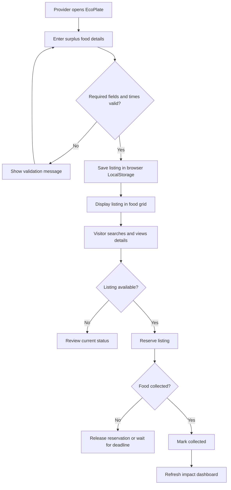
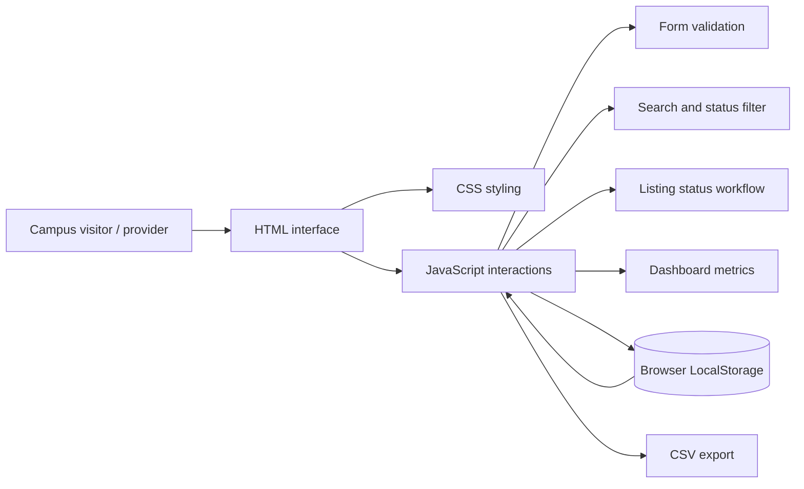
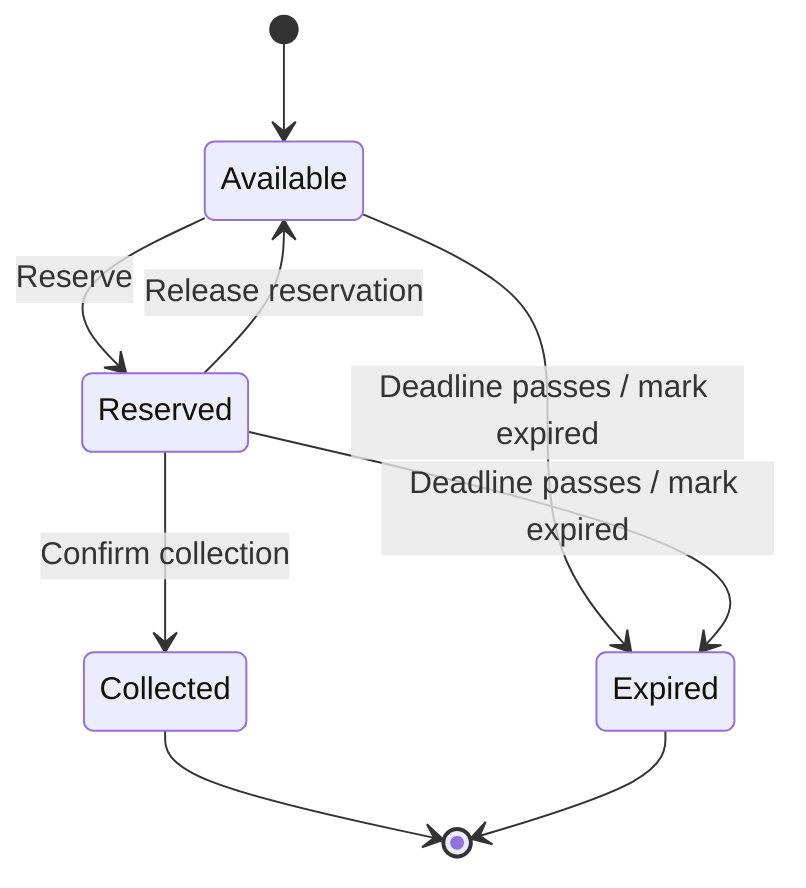

# EcoPlate Workflow and Architecture

Copy these Mermaid diagrams into a Mermaid-compatible editor or use them as a basis for diagrams in your report. Verify the diagrams render correctly before submission.

## User workflow

## Prototype architecture

## Listing status lifecycle

## Architecture note

This diagram describes the current browser-only prototype. LocalStorage is not a shared server database. The application does not implement authentication, server APIs or cross-device synchronization.
